<div align="center">

# PEACH DASH

**Run Atlanta at golden hour. Grab the peaches. Outrun the geese. Don't eat a food truck.**

A 3D endless runner in your browser: low-poly Atlanta, a painted day-to-night skyline, six power-ups, trains you can run on top of, and haptics on everything.


</div>

## Play it

```bash
npm install
npm run dev        # http://localhost:5173  (also on your phone via the Network URL)
```

1. Hit **PLAY**. An angry goose flock chases you off the line.
2. Dodge, jump, slide. Grab peaches, power-ups, Peach Crates and the letters of A-T-L-A-N-T-A.
3. Finish three missions to level up your score multiplier. Spend peaches on new runners and longer power-ups.

## Controls

| | Keyboard | Touch |
|---|---|---|
| Change lane | `A` `D` / arrows | swipe left / right |
| Jump | `W` / `Up` / `Space` | swipe up |
| Slide (or slam down mid-air) | `S` / `Down` | swipe down |
| Pause | `Esc` / `P` | pause button |

## Power-ups

Each has its own 3D pickup, HUD timer chip, on-runner visual state, synthesized sound and haptic pattern. Every one can be upgraded 5 times in **POWERS** (+20% duration per level, 120 / 240 / 420 / 650 / 950 peaches).

| Pickup | Name | What it does | Base time |
|---|---|---|---|
| Glazed drumstick, lemon wedge | **Lemon Pepper Wing** | Speed burst, smashes through everything, scatters the geese | 6 s |
| Tall cup, ice, lemon slice | **Sweet Tea** | Peach magnet | 10 s |
| Skillet with lattice crust and a floating 2x | **Peach Cobbler** | Double score | 12 s |
| Sneaker on a red spring | **Super Kicks** | Super jump, hop straight onto trains | 14 s |
| Ring of gondolas with thrusters | **SkyView Glide** | Fly above the lanes, collect a peach trail | 6 s |
| Glowing hoverboard | **BeltLine Board** | Shield, absorbs one crash | 18 s |
| Wooden crate with a "?" | **Peach Crate** | Mystery reward: peaches or any power-up | instant |

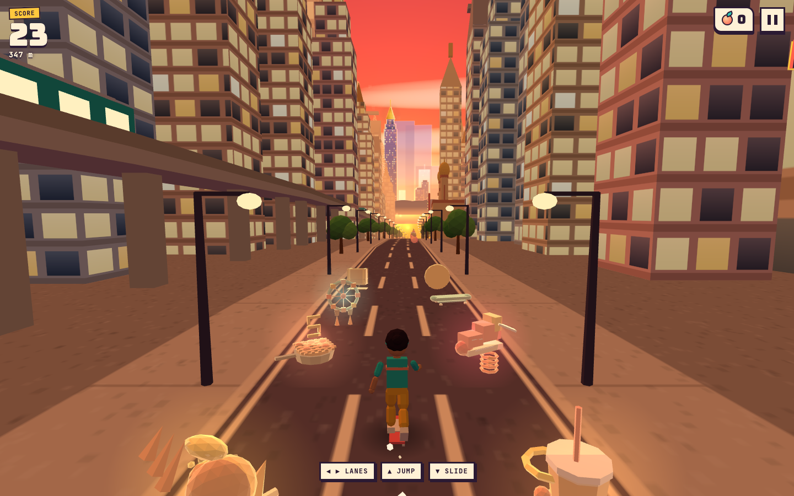

## Runners


| Runner | Archetype | Perk |
|---|---|---|
| JUNO | BeltLine skater | Near-misses pay double |
| TAY | Campus stepper | Lanes snap 45% faster, stumbles are forgotten 40% sooner |
| ROOK | Westside producer | Power-ups last 60% longer |
| MISS PEARL | Grant Park grandma | +30% peaches, starts with Sweet Tea |
| DEZ | Stadium sprinter | Every run opens with a 4 s Lemon Pepper Wing |
| NOVA | SkyView operator | Crates always hold a power-up, Glide lasts 40% longer |

All characters are original archetypes built from primitives in code. No real people, no brands.

## What you get

- **A chaser.** An angry goose flock starts on your heels. Outrun it (about 17 s), grab a Wing or Glide to scatter it. If it catches you after a stumble, you are goosed.
- **Stumble, then crash.** The first side clip makes you stumble (slower, red warning bar). A second clip inside 5.5 s crashes you. Head-on hits crash at once. The board shield eats either.
- **Trains.** Take a ramp and run along the roof of an elevated rail car, collecting peaches and crates. Super Kicks can hop straight on. The roof ends, you drop.
- **More traffic.** Food trucks, cones, barriers, scooters, wide barricades, low signs (slide or jump) and moving cars that roll toward you.
- **Missions and levels.** Three missions at a time. Finish the set, gain a level, earn +10% score multiplier (cap level 20) and a peach bonus.
- **ATLANTA letter hunt.** Letters appear on the course in order. Spell the word within a day for 300 peaches. Progress carries across runs.
- **Daily login reward** with a 7 day streak (50 up to 500 peaches), plus the date-seeded **daily mission**.
- **Local top 10.** Your best ten runs, with rank shown on the game-over screen.
- **Juice everywhere.** Vibration patterns, screen shake, hit-stop, speed lines, particle bursts, a procedural beat and synthesized SFX. No audio files.
- **Fast.** Instanced scenery, pooled obstacles, capped pixel ratio.

<p>
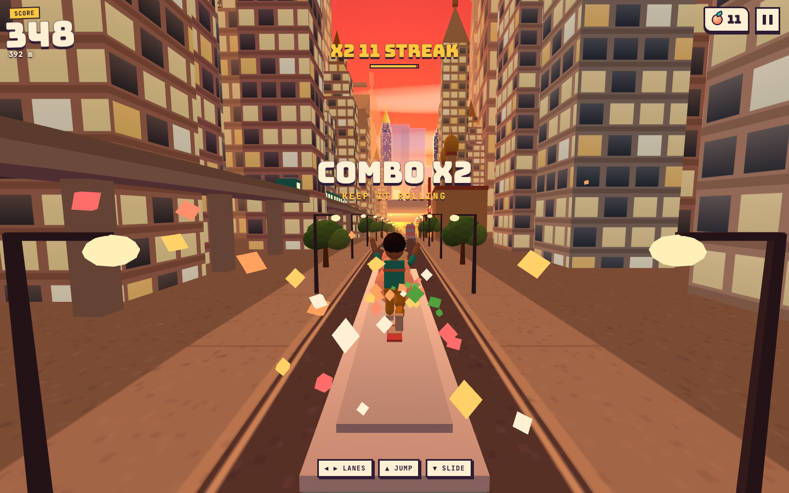 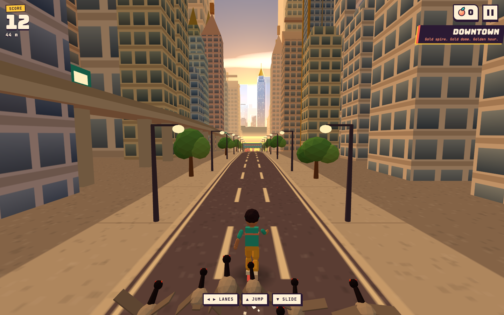
</p>
<p>
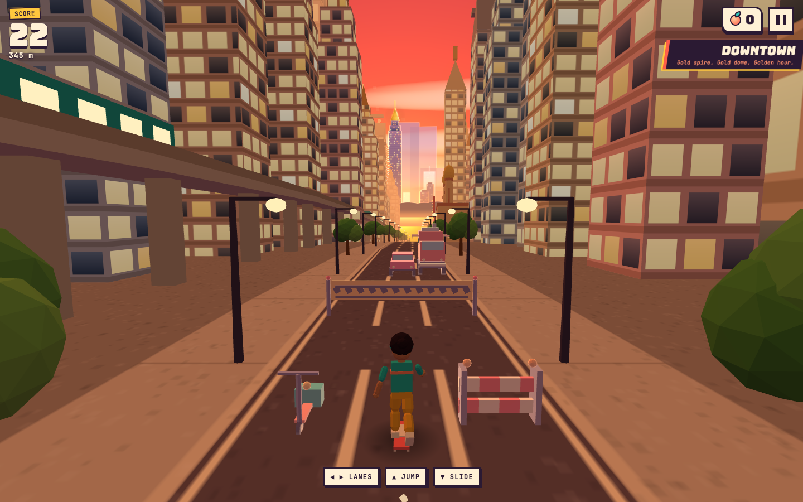 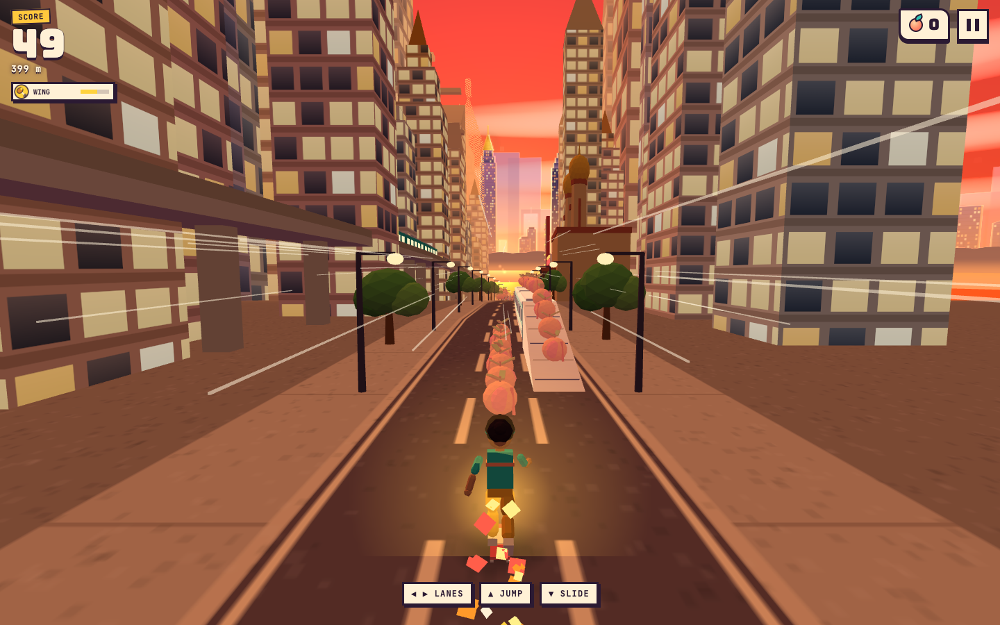
</p>

## Scenery

- **Real Atlanta silhouettes** painted from reference descriptions: Bank of America Plaza's gold pyramid spire, the Westin Peachtree cylinder with its ring disc, Truist Plaza's stepped crown and mast, One Atlantic Center's steep hipped roof, 191 Peachtree's twin crowns, Georgia-Pacific's stair-step, the petal-roofed stadium and the SkyView wheel.
- **Skyline backdrop** on concentric cylinders behind the 3D city: clouds, hazy far towers, the landmark layer and a dark treeline. Day, golden hour and night paintings crossfade with the day/night cycle and the layers sway against each other as the road bends.
- **How it was made.** The brief was Gemini-generated panoramas. The Gemini image API answered `429 RESOURCE_EXHAUSTED (limit: 0)` for this key, so per the fallback plan the three skylines are painted procedurally on canvas in `src/game/skyline.ts`. No stock photos and no other image model were used.

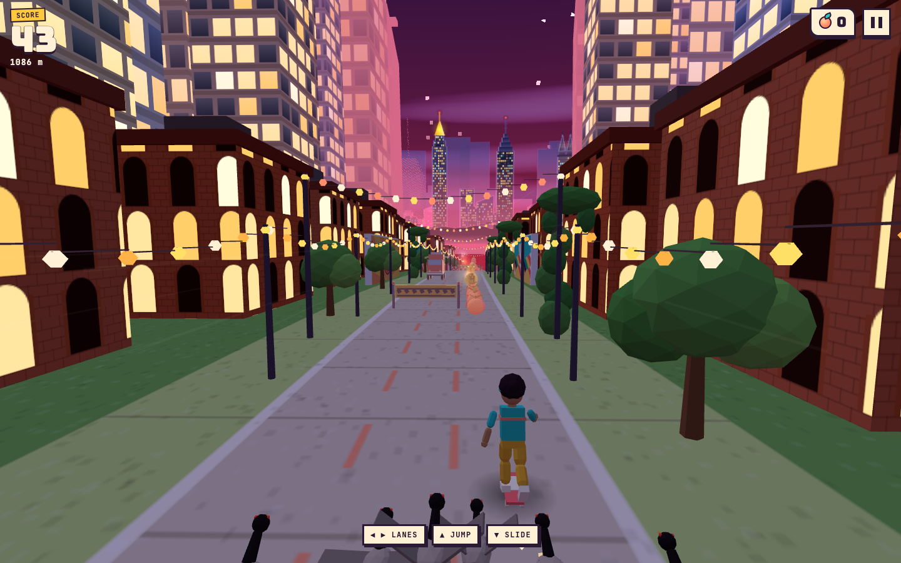

## No ground pop-in

The floor used to appear in front of the runner. Root cause: the world-bend shader sank the road below a flat floor plane after about 40 m, so it rose into view like a hill crest. Fixed by:

- an infinite-looking floor plane far below the bent road, the exact fog colour;
- road and ground chunks 700 m wide with a clamped lot colour, so there is no visible edge;
- fog from 70 to 330 m, with chunks, scenery, obstacles and pickups built out to 400 m so everything fades in from fog;
- a screen-door dissolve between 338 and 394 m so far scenery never pops;
- all chunks prewarmed before the first frame, and a much gentler bend.

## Screens

<p>
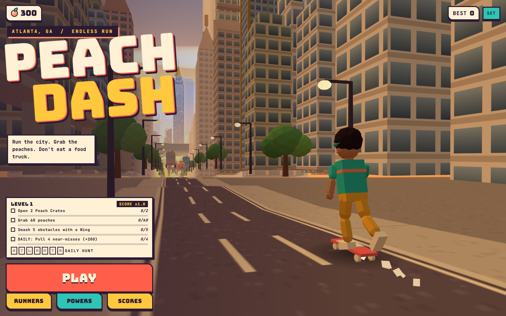 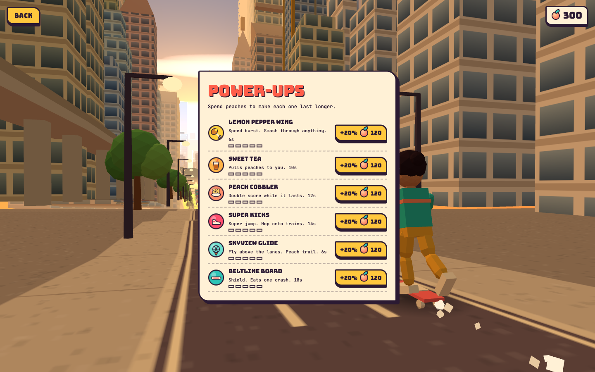
</p>
<p>
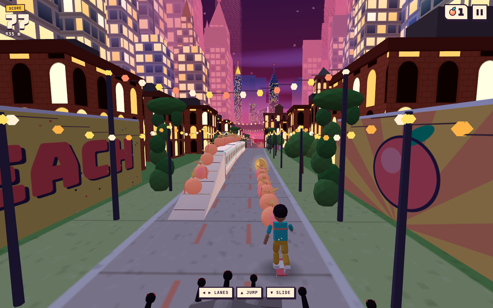 
</p>
<p>
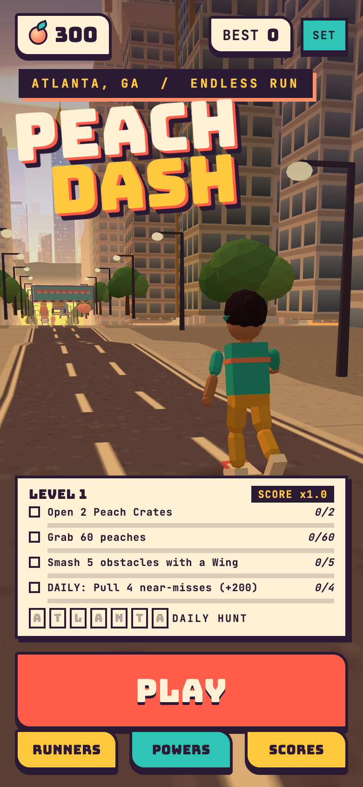  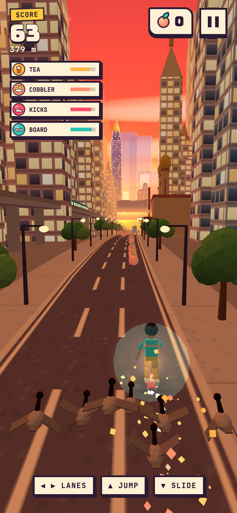
</p>

## Dev

```bash
npm test           # vitest: lanes, collision, spawner, autopilot soak, power-up timers, stumble rule,
                   # chaser, trains, missions, letter hunt, login, leaderboard, save
npm run build      # typecheck + production build into dist/
npm run preview    # serve dist/
node scripts/shoot.mjs   # Playwright screenshots at 1440x900 and 390x844 (needs a preview server on :4173)
node scripts/record.mjs  # README gif, character strip and screenshots
```

Core game logic lives in `src/core` (pure TypeScript, no three.js, fully tested, including an autopilot that must survive 6000 m on several seeds). Rendering lives in `src/game`.

Debug URLs: `?screen=runners&char=2`, `?screen=play&bot=1&at=900` (autopilot at 900 m), `?login=0` (skip the login modal), `?fresh=1` (ignore the save, dev builds only).

Stack: Vite, TypeScript, three.js, Web Audio, Vibration API. Fonts: Bungee and JetBrains Mono.

## Repo description and topics

**Description:** 3D endless runner through a low-poly Atlanta, GA. Power-ups, trains, geese, golden hour to night, haptics. Vite + three.js + TypeScript.

**Topics:** `endless-runner` `threejs` `webgl` `typescript` `vite` `browser-game` `low-poly` `atlanta` `game-dev` `web-audio` `mobile-game`
