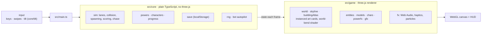

# PEACH DASH

A 3D endless runner through Atlanta that runs in the browser, with no install and no game engine.

**[Play it →](https://peach-dash.vercel.app)**


```bash
npm install
npm run dev     # the Network URL also works on your phone
npm test        # 51 tests
```

## How to play

Swipe, or use the arrow keys: left and right change lanes, up jumps, down slides. On a phone you can also turn on **Tilt Steer** in Settings. Outrun the geese, collect peaches, and spend them on runners and longer power-ups.

**Badge sets:** five badges appear in order during a run: ATL Plate, The Perimeter, Red Hawk, Fire Star and Junkyard Dog. Collect all five for 12 seconds of x5 score.

| Power-up | What it does |
|---|---|
| **Lemon Pepper Wing** | Speed burst that smashes through obstacles and scatters the geese |
| **Sweet Tea** | Pulls peaches toward you |
| **Peach Cobbler** | Doubles your score |
| **Super Kicks** | Super jump, high enough to land on a train |
| **SkyView Glide** | Flies above the lanes along a peach trail |
| **BeltLine Board** | Absorbs one crash |
| **Peach Crate** | Mystery reward |

Also in the game: six runners with their own perks, trains you can run on, three-mission sets that raise your multiplier, a daily A-T-L-A-N-T-A letter hunt, a login streak, and a local top 10.


## How it works

- **The game logic has no renderer.** `src/core` is plain TypeScript with no three.js import, so lanes, collision, spawning, scoring, missions and saves all run under `node`. The renderer in `src/game` only draws what the simulation decides.
- **The spawner is tested by playing it.** An autopilot has to survive 6,000 m across several seeds, which catches impossible obstacle patterns that unit tests would miss.
- **Illustrated scenery on flat cards.** Buildings, trees and murals are inked art in `public/art`, each drawn as a single instanced quad, so the city costs very little to draw. Sources are in `art-src`, and `scripts/build-buildings.mjs` keys them into atlases. Characters, vehicles, sound and music are still built in code. The production build is about 3 MB.
- **Built for smooth play.** Obstacles and pickups are prepared before the run, art uploads as it arrives, and resolution steps down if frames stay slow. A jump pressed just before landing or just after leaving an edge still counts. `scripts/smooth.mjs` measures frame pacing under a 4x CPU slowdown.
- **The wallpaper can't show a seam.** It sits on a full ring around the camera, and the texture mirrors at its edges, so the join stays continuous on any screen shape. Its foot fades into the road fog and its top into the sky. If the images fail to load, the game paints its own skyline in code.
- **Tested in a real browser too.** `scripts/e2e.mjs` runs the production build through tilt steering, vibration calls, a full badge set and blocked wallpaper files.
- **Built for phones.** Instanced scenery, pooled obstacles and a capped pixel ratio keep draw calls low (about 80 in the v1 profile, not re-measured since the v2 additions).
- **No ground pop-in.** The world-bend shader used to sink the road below a flat floor, so the road rose into view like a hill. The floor now sits far below the bent road in the exact fog color, and chunks are built past the fog line and prewarmed before the first frame.

## Architecture



The simulation decides and the renderer only draws, which is why `npm test` can play whole runs under Node.

## Tests

```bash
npm test                                    # Vitest: simulation, spawner, powers, saves
npm run build && npx vite preview --port 4173 &
node scripts/e2e.mjs                        # real-browser checks on the production build
```

Last run on 2026-11-16:

- **51 of 51 Vitest tests passed** (2 files), including the autopilot that must survive 6,000 m across several seeds.
- `npm run build` type-checked cleanly and produced a 3.07 MB build.
- **25 of 25 real-browser checks passed** in `scripts/e2e.mjs` (desktop art loading, tilt steering, swipes, badge-set boost, vibration patterns, the iPhone haptics path, and the painted-skyline fallback).
- The live site's first load transferred 2.19 MB on desktop and 1.95 MB on a phone (Playwright, Chromium).

## Limits

- **All the 2D art is AI-generated**, so it's a stylized Atlanta, not an exact one.
- **Frame numbers come from an Apple M3.** Real phones have not been measured.
- **Saves stay in `localStorage`**, so there are no accounts, cloud saves or global leaderboard.
- **Haptics depend on the phone.** Android uses the Vibration API. iOS Safari has none, so the game plays the system tick from a hidden switch control, which has not been confirmed on a real iPhone.
- **Tilt Steer is off by default.** It has been tested with simulated motion events, not on a real phone. iOS asks for motion permission when you turn it on.
- **Sound and haptics have only been exercised by code paths** in automated runs. Performance numbers come from a headless run on an Apple M3, not from a range of phones.

All runners are original low-poly models, and the game uses no team logos. The train and bus borrow the silver-and-stripe look of Atlanta transit without its name or logo. This is a fan project, not affiliated with MARTA or any team.

## Stack

Vite, TypeScript, three.js, Web Audio, Vitest. Debug URLs such as `?screen=play&bot=1&at=900` start the autopilot 900 m in.

## Status

Live at [peach-dash.vercel.app](https://peach-dash.vercel.app). Automated checks pass in Chromium; it still needs a pass on real phones for haptics, tilt and frame pacing (see Limits).

## Roadmap

- Measure frame pacing, haptics and Tilt Steer on real iPhone and Android devices.
- Re-measure draw calls after the v2 scenery.
- A global leaderboard (saves are local only today).

## Credits

- Made by [Akinwale Dare](https://github.com/Waleee7).
- 2D art (buildings, trees, murals, badges) is AI-generated and keyed into atlases by `scripts/build-buildings.mjs`; characters, vehicles, sound and music are built in code.
- [three.js](https://threejs.org) (MIT). Fonts: Bungee and JetBrains Mono through Fontsource (SIL Open Font License).
- A fan project, not affiliated with MARTA or any team.

MIT licensed, see [LICENSE](LICENSE).
