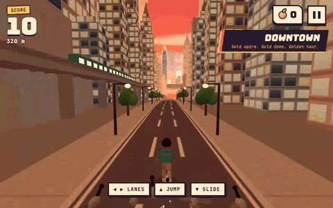
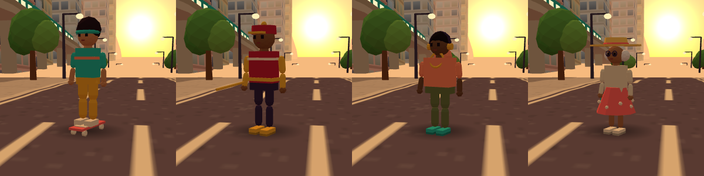
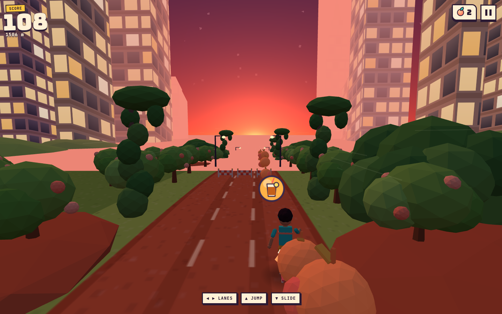
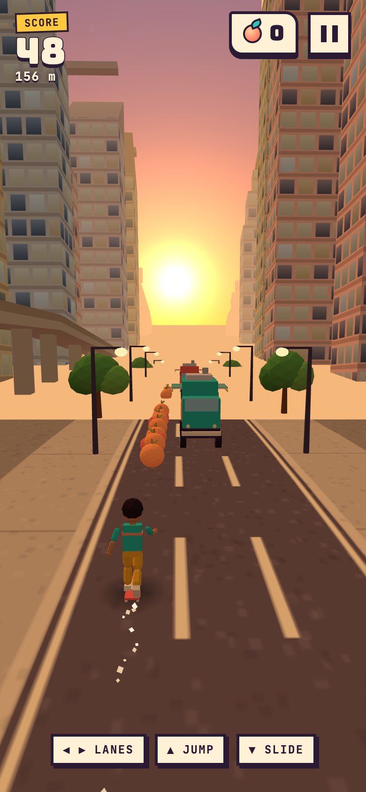

<div align="center">

# PEACH DASH

**Run Atlanta at golden hour. Grab the peaches. Don't eat a food truck.**

A 3D endless runner in your browser: low-poly Atlanta, a day-to-night skyline, and haptics on everything.



</div>

## Play it

```bash
npm install
npm run dev        # http://localhost:5173  (also on your phone via the Network URL)
```

1. Hit **PLAY**.
2. Dodge, jump, slide. Grab peaches.
3. Spend peaches on new runners. Beat the daily mission.

## Controls

| | Keyboard | Touch |
|---|---|---|
| Change lane | `A` `D` / arrows | swipe left / right |
| Jump | `W` / `Up` / `Space` | swipe up |
| Slide (or slam down mid-air) | `S` / `Down` | swipe down |
| Pause | `Esc` / `P` | pause button |

## What you get

- **Three districts, one sun.** Downtown (gold-lattice spire, gold-dome Capitol, Moorish marquee theatre, elevated rail), The BeltLine (brick warehouses, murals, string lights, kudzu), Peach Park (ferris wheel, orchard, red clay). Golden hour fades to night as you run.
- **Near misses, combos, turbo pads, second chance.** Sweet Tea pulls peaches to you. The Beltline Board eats one crash.
- **Juice everywhere.** Vibration patterns for peaches, jumps, near-misses, power-ups and crashes. Screen shake, hit-stop, speed lines, peach bursts, synthesized SFX and a procedural beat (no audio files).
- **Daily mission** that is the same for everyone on a given date. Progress and unlocks save to `localStorage`.
- **Fast.** Instanced scenery, pooled obstacles, capped pixel ratio. About 80 draw calls and over 100 fps on an M-series laptop.

## Runners



| Runner | Archetype | Perk |
|---|---|---|
| JUNO | BeltLine skater | Near-misses pay double |
| TAY | Campus stepper | Lane changes snap 45% faster |
| ROOK | Westside producer | Power-ups last 60% longer |
| MISS PEARL | Grant Park grandma | +30% peaches, starts with Sweet Tea |

All characters are original archetypes built from primitives in code. No real people, no brands.

## Screens

<p>
 
</p>
<p>
  
</p>

## Dev

```bash
npm test           # vitest: lanes, collision, spawner, scoring, save, daily mission
npm run build      # typecheck + production build into dist/
npm run preview    # serve dist/
node scripts/shoot.mjs   # Playwright screenshots (needs a preview server on :4173)
```

Core game logic lives in `src/core` (pure TypeScript, no three.js, fully tested, including an autopilot that must survive 6000 m on several seeds). Rendering lives in `src/game`.

Debug URLs: `?screen=runners&char=2`, `?screen=play&bot=1&at=900` (autopilot at 900 m), `?fresh=1` (ignore the save).

Stack: Vite, TypeScript, three.js, Web Audio, Vibration API. Fonts: Bungee and JetBrains Mono.

## Repo description and topics

**Description:** 3D endless runner through a low-poly Atlanta, GA. Golden hour to night, haptics, synthesized beats. Vite + three.js + TypeScript.

**Topics:** `endless-runner` `threejs` `webgl` `typescript` `vite` `browser-game` `low-poly` `atlanta` `game-dev` `web-audio` `mobile-game`
